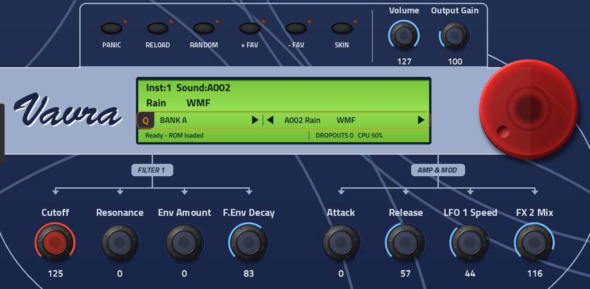
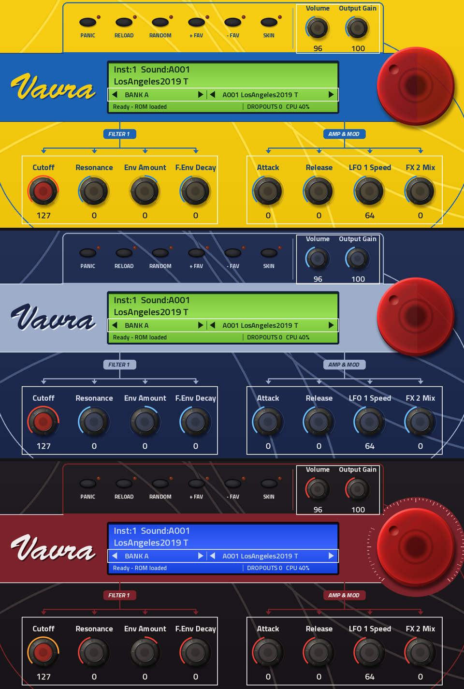
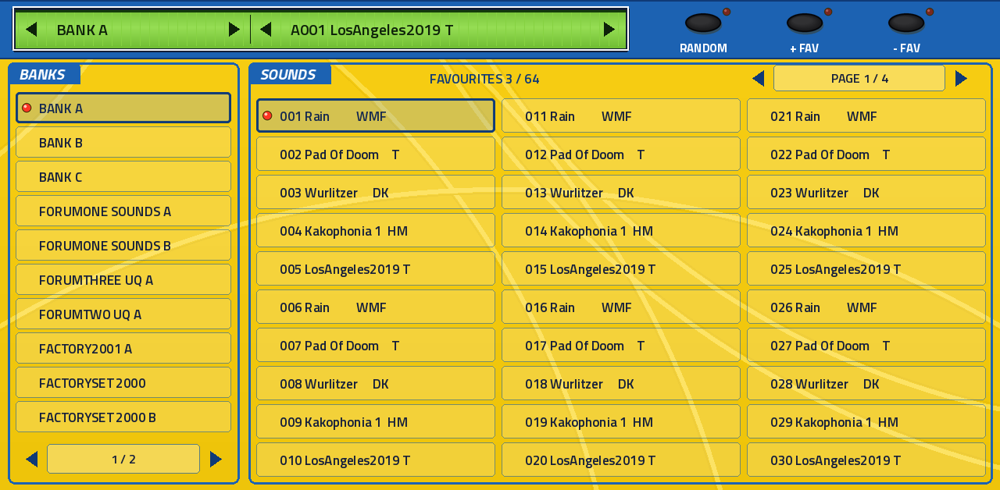
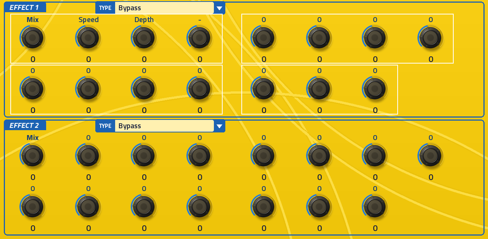

# Vavra for MPC

A Waldorf microQ emulation that runs as a plugin instrument on **64-bit Akai MPC standalones** (MPC Live III and other Gen2 MPCs),
with a full touchscreen editor and Q-Link control.

It runs the microQ's original firmware on [gearmulator](https://github.com/dsp56300/gearmulator)'s emulation of the synth's chips (its 68k
controller and DSP56362 voice DSP). "Vavra" is gearmulator's name for its microQ plugin. Version 1.0 has a native MPC screen in the look of the
microQ's front panel, in three skins.



## Features
- **The real microQ engine:** the original OS 2.23 runs on emulated hardware: 3 oscillators, 2 multimode filters, 4 envelopes, 3 LFOs,
  the modulation matrix, both effects and the arpeggiator of the original.
- **All 300 ROM sounds** in banks A, B and C, plus your own **sound-set files** (`.mid` / `.syx`, such as Waldorf's factory sets 2000 and 2001
  or the Forum sets) as extra banks, 100 sounds each.
- **MAIN like the microQ's front:** the keys in a panel over the green LCD (bank and sound with step arrows, status and DSP load), the red data
  dial that steps through the sounds, and eight big performance knobs (filter 1 and amp / modulation) with Volume and Output Gain.
- **Three skins:** the yellow **microQ**, the **Dark Blue** microQ and the **Phoenix Edition** (charcoal and maroon, blue LCD). The SKIN key
  steps through them; the choice applies to every Vavra on the MPC and stays until you change it.
- **RANDOM:** a random sound from every loaded bank (MAIN and BANKS).
- **Named favourites in the MPC PRESET menu:** **+FAV** opens an on-screen keyboard with the sound's name; edit it and SAVE. Pick favourites from
  MPC's own preset list; **-FAV** removes the one that is picked. Up to 64, kept across projects.
- **A complete editor on the touchscreen:** 15 pages.
  - **MAIN**, **BANKS** (the bank list and a sound browser, 30 sounds a page)
  - **OSC 1/2**, **OSC 3/MIX:** the three oscillators, pitch modulation, the mixer
  - **FILTERS**, **ENVELOPES**, **AMP & GLIDE**, **LFO**
  - **MOD FAST**, **MOD SLOTS**, **MODIFIERS:** the modulation matrix
  - **FX:** both effects; the knobs take the names of the chosen effect's parameters
  - **ARP**, **ARP STEPS 1-8**, **ARP STEPS 9-16:** the arpeggiator and its 16-step user pattern
  - Choices open as drawn pick-lists; every block of four controls is a Q-Link group.
- **Follows MPC's tempo:** while MPC plays, the arpeggiator and clocked LFOs run at MPC's tempo, in time with the song.
- **Saved with your project:** the current sound and every edit come back when the project is reopened. Projects saved with 0.1.0 still load.
- **Light on CPU:** about 45-50% of one core on an MPC Live III, on the fast cores.





## Requirements
- A 64-bit MPC (Gen2, e.g. MPC Live III) running **MPC OS 3.10.1 or later**. Gen1 devices and the Force aren't supported.
- **Your own microQ ROM.** No ROM is included, and none may be shared. Use a **512 kB flash dump** (`.bin`, OS 2.23, as read from the chip or
  byte-swapped: both work). The OS update file `mq_2_23.mid` also boots, but it holds no factory sounds, so banks A to C are then empty.

## Install
Download one of these from [Releases](https://github.com/sd88me/mpc-vst-vavra/releases):
- **`Vavra-<version>-mpc-sdk.zip`**: the plugin folder `sd88me - VST - Vavra`. Copy it into a `VST2 Plugins` folder on a drive of the MPC, put your
  ROM in its `vavra/roms/` (sound sets in `vavra/banks/`), and restart the MPC. Turn on **Preferences > Enhancements (Beta) > Enable Enhancements**
  and **External Plugin Support** first. Vavra is then listed under External VST Plugins > sd88me.
- **`Vavra-<version>-mpc-aarch64.zip`**: run `install.sh` on the device as root (see its INSTALL.md). It upgrades a 0.1.0 install in place and keeps
  your ROM, sound sets and favourites. The desktop Plugin Manager uses this one too.

Use one of the two, not both.

The firmware boots in about 2 seconds. **The first time**, Vavra then reads the names and data of the 300 ROM sounds in the background, which
takes about a minute (the status line shows "reading sound names"); they are kept in `vavra/sounds.dat`, so later loads have them at once.

## Tips
- Notes from the MPC play the microQ on MIDI channel 1 (it listens on all channels).
- A MIDI program change picks a sound from the current bank; bank select (CC 0) picks the bank.
- **RELOAD** reverts the edits to the stored sound. **PANIC** stops stuck notes.
- When MPC is stopped, the arpeggiator runs at the sound's own tempo (ARP page).
- The FX knobs show "-" where the chosen effect has no parameter.
- A hot sound can drive the microQ's own output into clipping (as the patch's Volume nears 127); turn the sound's Volume (AMP & GLIDE) down a little.



## Building from source
Needs Docker (the aarch64 cross compiler image is built on first use), Python 3 with Pillow, a checkout of Akai's MPC Plugin SDK (`MPC_SDK`, default
`~/mpc-plugin-builder-sdk`) and of [mpc-vst-plugins](https://github.com/sd88me/mpc-vst-plugins) (`MPC_VST`, for `wrapper/engine.h` and the release tools):
```
./build-sdk.sh                  # the plugin folder build/sdk/"sd88me - VST - Vavra" (no ROM)
./build-sdk.sh test             # the offline host test (ASan/UBSan, needs your ROM in ./data/roms) and host_sim
./build-sdk.sh beta             # "Vavra 2 Beta" (its own uid), to install next to the release while testing
tools/package_catalog.sh        # dist/Vavra-<ver>-mpc-aarch64.zip and -mpc-sdk.zip, SHA256SUMS
python3 tools/make_tui.py --preview   # the skins, and drawings of every page in docs/skin-preview/
```
`src/dsp/vavra_engine.cpp` drives gearmulator's microQ on a thread of MPC's own process. `src/VavraPlugin.cpp` is the plugin: the parameter table
(`tools/gen_sdk_params.py` from `params.lock`, whose order is frozen and only ever appended to), the saved state, favourites, the naming keyboard
and the skin switch. `tools/make_tui.py` and `tools/vavra_art.py` draw every page in all three skins into one `TUI.json`.

## Credits
Vavra for MPC is built on other people's work. See [CREDITS.md](CREDITS.md) for the details.
- **[gearmulator](https://github.com/dsp56300/gearmulator)** by dsp56300 and contributors: the microQ emulation and the Vavra plugin it comes from.
- **The "mqDefault" skin** by theusualsuspects: the "Vavra" script on MAIN.
- **Akai's MPC Plugin SDK** (MIT): the plugin framework; **[mpc-vst-plugins](https://github.com/sd88me/mpc-vst-plugins):** the release tools.
- **Titillium Web** (SIL OFL 1.1): the fonts of the screen.

## Licence
**GPL-3.0**: see [LICENSE](LICENSE). The bundled components keep their own licences (GPL-3.0, zlib, BSD/LGPL, SIL OFL 1.1), as listed in CREDITS.md.

*Vavra for MPC is an independent project, not affiliated with or endorsed by Waldorf. "microQ" is the name of the instrument it emulates.
Waldorf and microQ are trademarks of their owners.*
