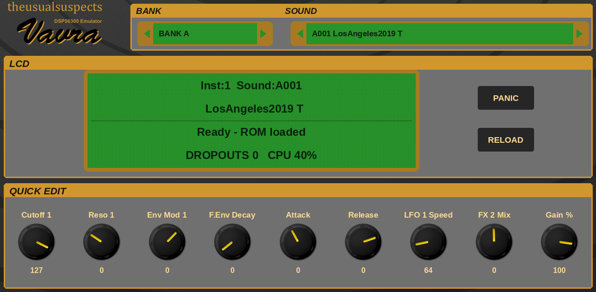
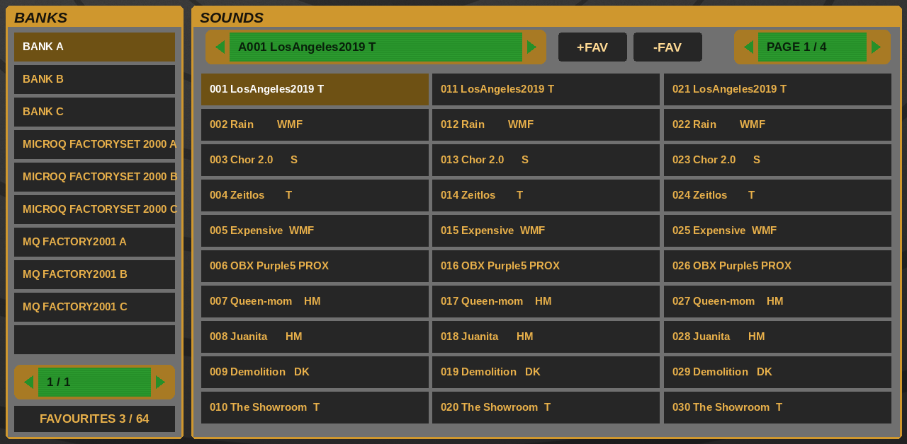
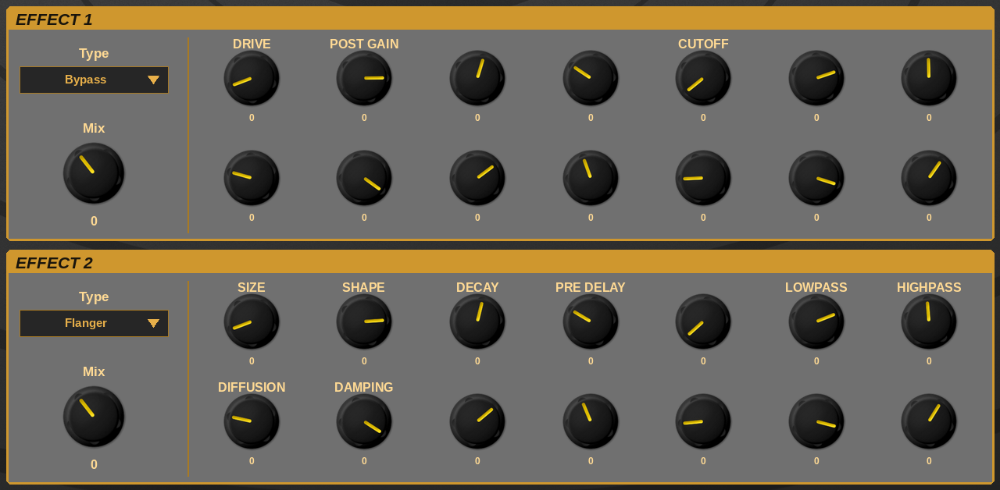

# Vavra for MPC

A Waldorf microQ emulation that runs as a plugin instrument on **Akai MPC Gen2 standalone devices** (MPC Live III and other aarch64 MPCs),
with a full touchscreen editor and Q-Link control.

It runs the microQ's original firmware on [gearmulator](https://github.com/dsp56300/gearmulator)'s emulation of the synth's chips (its 68k
controller and DSP56362 voice DSP). "Vavra" is gearmulator's name for its microQ plugin; the look comes from its "mqDefault" skin by theusualsuspects.



## Features
- **The real microQ engine:** the original OS 2.23 runs on emulated hardware: 3 oscillators, 2 multimode filters, 4 envelopes, 3 LFOs,
  the modulation matrix, both effects and the arpeggiator of the original.
- **All 300 ROM sounds** in banks A, B and C, plus your own **sound-set files** (`.mid` / `.syx`, such as Waldorf's factory sets 2000 and 2001
  or the Forum sets) as extra banks, 100 sounds each.
- **Favourites in the MPC PRESET menu:** press **+FAV** on any sound to save it, then pick it from MPC's own preset list. **-FAV** removes it.
  Up to 64 favourites, kept across projects.
- **The microQ's own LCD** on the MAIN page, live, in its green.
- **A complete editor on the touchscreen:** 15 pages.
  - **MAIN:** bank and sound, the LCD, engine status, PANIC, RELOAD and 9 quick-edit knobs
  - **BANKS:** the bank list and a sound browser, 30 sounds a page, favourites
  - **OSC 1/2**, **OSC 3/MIX:** the three oscillators, pitch modulation, the mixer
  - **FILTERS**, **AMP & GLIDE**, **ENVELOPES**, **LFO**
  - **MOD FAST**, **MOD SLOTS**, **MODIFIERS:** the modulation matrix
  - **FX:** both effects; the knobs take the names of the chosen effect's parameters
  - **ARP**, **ARP STEPS 1-8**, **ARP STEPS 9-16:** the arpeggiator and its 16-step user pattern
- **Follows MPC's tempo:** while MPC plays, the arpeggiator and clocked LFOs run at MPC's tempo, in time with the song.
- **Q-Links:** each page's knobs are mapped to the Q-Links.
- **Saved with your project:** the current sound and every edit come back when the project is reopened.
- **Light on CPU:** about 45% of one core on an MPC Live III, on the fast cores.



## Requirements
- An MPC Gen2 standalone device (aarch64, e.g. MPC Live III) running **MPC OS 3.10 or later**. Gen1 devices and the Force aren't supported.
- **Your own microQ ROM.** No ROM is included, and none may be shared. Use a **512 kB flash dump** (`.bin`, OS 2.23, as read from the chip or
  byte-swapped: both work). The OS update file `mq_2_23.mid` also boots, but it holds no factory sounds, so banks A to C are then empty.

## Install
1. Download `Vavra-<version>-VST2-Plugins.zip` from [Releases](https://github.com/sd88me/mpc-vst-vavra/releases) and unzip it.
2. Copy the `VST2 Plugins` folder to the root of a drive the MPC can see (internal storage, SD card or USB drive). If that drive already has a
   `VST2 Plugins` folder, copy the `sd88me - VST - Vavra` folder into it.
3. Put your ROM in `VST2 Plugins/sd88me - VST - Vavra/VST/vavra/roms/`.
4. Optional: put sound-set files in `.../VST/vavra/banks/`.
5. On the MPC, turn on **Preferences > Enhancements (Beta) > Enable Enhancements and VST2 Support**, then restart.
6. Load **Vavra** on a plugin track from the External VST Plugins list.

The firmware boots in about 2 seconds. **The first time**, Vavra then reads the names and data of the 300 ROM sounds in the background, which
takes about a minute (STATUS shows "reading sound names"); they are kept in `VST/vavra/sounds.dat`, so later loads have them at once. Sounds
picked during that first minute play correctly, but the screen may show the previous sound's name and values.

## Tips
- Notes from the MPC play the microQ on MIDI channel 1 (it listens on all channels).
- A MIDI program change picks a sound from the current bank; bank select (CC 0) picks the bank.
- **RELOAD** reverts the edits to the stored sound. **PANIC** stops stuck notes.
- When MPC is stopped, the arpeggiator runs at the sound's own tempo (ARP page).
- The FX knobs show "-" where the chosen effect has no parameter.



## Building from source
You need Docker, Python 3 with Pillow, and a checkout of [mpc-vst-plugins](https://github.com/open-mpc/mpc-vst-plugins). Point `MPC_VST` at it
(the default is `~/mpc-vst-plugins`).
```
./build.sh test               # x86 engine + the wrapper's host test (ASan/UBSan)
./build.sh all                # aarch64 vst/build/aarch64/vavra.so + the skin
tools/package_310.sh 0.1.0    # dist/Vavra-0.1.0-VST2-Plugins.zip
tools/preview.py out/         # offline previews of every page
```
`build/<arch>/vavra_engine_test <dir with roms/>` boots the ROM and checks notes, sounds, parameters, sound-set banks and the saved state.
Run the aarch64 one on the device.

## Credits
Vavra for MPC is built on other people's work. See [CREDITS.md](CREDITS.md) for the details.
- **[gearmulator](https://github.com/dsp56300/gearmulator)** by dsp56300 and contributors: the microQ emulation and the Vavra plugin it comes from.
- **The "mqDefault" skin** by theusualsuspects: the background, the Vavra logo and the knobs.
- **[mpc-vst-plugins](https://github.com/open-mpc/mpc-vst-plugins):** the MPC plugin wrapper and skin tools.

## Licence
**GPL-3.0**: see [LICENSE](LICENSE). The bundled components keep their own licences (GPL-3.0, zlib, BSD/LGPL, SIL OFL 1.1), as listed in CREDITS.md.

*Vavra for MPC is an independent project, not affiliated with or endorsed by Waldorf. "microQ" is the name of the instrument it emulates.
Waldorf and microQ are trademarks of their owners.*
